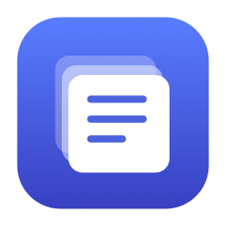

<p align="center"></p>

# Popvy (팝비)

**복사한 내용을, 커서 옆에서 다시 꺼내 쓰세요.**

Popvy는 `Option + V`로 여는 작은 macOS 클립보드 기록 앱입니다. 평소처럼 텍스트나 이미지를 복사하고, 필요한 순간 기록을 열어 한 번 클릭하면 입력하던 앱에 붙여넣습니다.

- 입력 커서 옆에 표시되는 간결한 목록. 커서 위치를 알 수 없으면 마우스 포인터 옆에 표시합니다.
- 텍스트와 이미지 기록, 검색, 자주 쓰는 항목 고정
- 첫 실행 권한 안내와 자동 감지
- 계정, 서버, 광고, 분석 도구 없이 Mac 안에서 동작

**[DMG 다운로드](https://github.com/kwakhyun/Popvy/releases/download/v1.3.0/Popvy-1.3.0-macos-universal.dmg)** · [모든 릴리스](https://github.com/kwakhyun/Popvy/releases) · [버그 제보](https://github.com/kwakhyun/Popvy/issues)

## 설치

**macOS 13 Ventura 이상**이 필요합니다. 배포 파일 하나에 **Apple Silicon과 Intel** 실행 파일이 모두 들어 있습니다. 설치에 Xcode나 터미널은 필요하지 않습니다. 현재 앱 화면은 한국어로 제공됩니다.

1. **[최신 릴리스](https://github.com/kwakhyun/Popvy/releases/latest)**에서 `Popvy-1.3.0-macos-universal.dmg`를 다운로드합니다. 저장소의 **Code → Download ZIP**은 개발용 소스입니다.
2. DMG를 열고 **Popvy.app을 Applications 폴더로 드래그**합니다.
3. 복사가 끝나면 디스크 이미지를 추출하고, 응용 프로그램 폴더에서 Popvy를 실행합니다.
4. 첫 안내의 **시스템 설정 열기**를 누르고 **손쉬운 사용 → Popvy**를 켭니다. 필요한 경우 Mac에서 직접 인증합니다.
5. 허용을 감지하면 안내가 완료 상태로 바뀝니다. **Popvy 시작하기**를 누르세요.

ZIP을 선호하면 `Popvy-1.3.0-macos-universal.zip`을 풀고 `Popvy.app`을 응용 프로그램 폴더로 옮기면 됩니다. 앱 아이콘은 Dock 대신 화면 위쪽 **메뉴 막대**에 나타납니다.

### 첫 실행이 차단된다면

**현재 1.3.0 배포본은 임시 서명(ad-hoc)을 사용하며 Apple Developer ID 서명과 공증을 받지 않았습니다.** 따라서 다운로드한 앱을 macOS가 차단할 수 있습니다.

다운로드 출처를 확인하고 실행하기로 결정했다면, 한 번 실행을 시도한 후 **시스템 설정 → 개인정보 보호 및 보안 → 그래도 열기**를 사용하세요. 조직에서 관리하는 Mac에서는 이 선택이 제한될 수 있습니다. 자세한 내용은 [Apple의 앱 안전 실행 안내](https://support.apple.com/ko-kr/102445)를 참고하세요.

### 자동 붙여넣기 권한

Popvy가 다른 앱에 붙여넣으려면 **손쉬운 사용 권한**이 필요합니다. 승인 자체는 사용자가 결정하며, Popvy는 설정 화면을 열고 약 1초 간격으로 승인 여부를 확인합니다. 허용되면 자동 붙여넣기를 켭니다.

- **나중에 하기**를 선택해도 기록과 검색은 사용할 수 있습니다. 항목을 선택한 다음 직접 `Command + V`를 누르세요.
- 다시 안내를 열려면 기록 창의 **바로 붙여넣기 허용** 또는 앱 설정의 **권한 설정**을 누릅니다.
- 권한 목록에 없다면 `+` 버튼으로 설치한 `Popvy.app`을 추가합니다.
- macOS가 클립보드 읽기 허용을 별도로 요청하면, 기록 수집을 위해 읽기를 허용해 주세요.

## 사용하기

1. Popvy를 실행한 상태에서 `Command + C`로 복사합니다.
2. 붙여넣을 입력란을 선택하고 `Option + V`를 누릅니다.
3. 기록을 클릭하거나 방향키로 고른 뒤 `Return`을 누릅니다.

기록 창의 `…` 메뉴에서 설정, 기록 일시 정지, 고정한 기록만 보기, 일괄 삭제를 사용할 수 있습니다. 항목의 `…` 또는 오른쪽 클릭으로 고정하거나 삭제할 수 있습니다. **로그인할 때 자동 실행**은 앱 설정에서 켭니다.

| 단축키 | 동작 |
| --- | --- |
| `Option + V` | 기록 창 열기 / 닫기 |
| `Command + F` | 검색 |
| `↑` / `↓` | 항목 선택 |
| `Return` | 붙여넣기. 권한이 없으면 복사 |
| `Shift + Return` | 복사만 하기 |
| `Command + Return` | 서식 없이 붙여넣기 |
| `Command + 1` ~ `9` | 현재 검색 결과의 해당 항목 선택 |
| `Esc` | 닫고 원래 앱으로 돌아가기 |

설정에서 호출 단축키를 `Control + Shift + V` 또는 `Command + Shift + V`로 바꿀 수 있습니다.

## 기록과 개인정보

- 텍스트, 링크, PNG/TIFF 이미지를 보관하며, 텍스트의 HTML/RTF 서식도 함께 저장합니다. 파일 복사는 수집하지 않습니다.
- 최근 **100개**, 전체 **50 MiB**, 항목당 **5 MiB**까지 보관하며 최대 **20개**를 고정할 수 있습니다.
- 기록은 `~/Library/Application Support/Popvy/history.json`에 저장합니다. 서버 전송이나 클라우드 동기화 기능은 없습니다.
- 기록 파일은 해당 사용자에게만 읽기와 쓰기를 허용하지만 **앱 수준 암호화는 적용하지 않습니다**.
- **앱을 종료해도 기록 보관**을 끄면 저장 파일을 삭제하고 실행 중 메모리에서만 보관합니다.
- 비밀번호 관리 앱이 민감한 데이터로 표시한 항목은 제외합니다. **일반 텍스트로 복사한 비밀번호나 인증번호까지 자동 판별하지는 않습니다.** 필요한 경우 수집을 일시 정지하세요.

앱이 꺼져 있거나 수집을 일시 정지한 동안 복사한 내용은 나중에 수집하지 않습니다.

## 문제 해결

**단축키를 눌러도 열리지 않아요.**

메뉴 막대에서 Popvy가 실행 중인지 확인하세요. 다른 앱의 단축키와 겹친다면 Popvy 설정에서 단축키를 바꿔 보세요.

**기록은 열리는데 자동으로 붙여넣지 않아요.**

손쉬운 사용 권한과 앱 설정의 **선택한 항목 바로 붙여넣기**를 확인하세요. 입력란을 먼저 선택해야 합니다. 보안 입력이나 앱 자체의 붙여넣기 제한이 있으면 직접 `Command + V`를 눌러야 할 수 있습니다.

**권한이 켜져 있는데도 허용되지 않았다고 나와요.**

앱을 다시 빌드하거나 업데이트한 뒤 발생할 수 있습니다. 손쉬운 사용 목록에서 Popvy를 제거하고, `+`로 현재 설치된 앱을 다시 추가해 켜 주세요.

**업데이트는 어떻게 하나요?**

메뉴 막대의 Popvy를 오른쪽 클릭해 종료한 다음 새 앱으로 교체합니다. 기록과 설정은 앱 바깥에 보관되므로 유지됩니다. 현재 자동 업데이트 기능은 없습니다. 이전 이름인 ClipShelf에서 옮기는 경우에는 [업그레이드 안내](docs/UPGRADING.md)를 참고하세요.

**완전히 삭제하고 싶어요.**

앱 설정에서 로그인 시 자동 실행을 끄고, 기록도 지우려면 **모든 기록 삭제**를 선택하세요. 앱을 종료한 뒤 응용 프로그램 폴더의 Popvy를 휴지통으로 옮깁니다. 남은 기록 파일은 `~/Library/Application Support/Popvy` 폴더에서 삭제할 수 있습니다.

## 소스에서 빌드

Swift 5.9 이상을 제공하는 Xcode 또는 Command Line Tools와 macOS 13 이상이 필요합니다. 외부 패키지 의존성은 없습니다.

```sh
# 현재 Mac용 .app 생성
bash scripts/build.sh
open build/Popvy.app

# Apple Silicon + Intel 통합 빌드
bash scripts/build.sh universal
```

소스 폴더의 `설치.command`는 개발용 설치 도구입니다. 현재 Mac용 앱을 빌드해 `~/Applications/Popvy.app`에 설치합니다. 일반 사용자는 Releases의 DMG를 사용하세요.

```sh
# 테스트 전용 pasteboard를 사용하며 실제 클립보드 기록은 건드리지 않습니다.
CLANG_MODULE_CACHE_PATH="$PWD/.build/clang-module-cache" \
SWIFTPM_MODULECACHE_OVERRIDE="$PWD/.build/module-cache" \
swift test --disable-sandbox

# DMG, ZIP, 소스 ZIP, SHA-256 체크섬 생성
bash scripts/release.sh
```

출력 경로, 공개 절차, 서명과 공증은 [배포 안내](docs/RELEASING.md)를 참고하세요. `--demo` 실행 옵션은 가상 기록만 보여주며 실제 클립보드를 수집하거나 기록 파일에 저장하지 않습니다. 실제 앱과 동시에 실행하지 마세요.

SwiftUI, AppKit, Carbon, ServiceManagement로 구현했습니다. 버그를 제보할 때는 macOS 버전, Mac의 칩 종류, Popvy 버전, 재현 방법을 포함해 주세요. 실제 클립보드 내용이나 비밀번호는 첨부하지 마세요.

## 라이선스

[MIT License](LICENSE). 사용, 수정, 재배포와 상업적 활용을 허용합니다. 재배포 시 저작권 표시와 라이선스를 포함해야 합니다.
